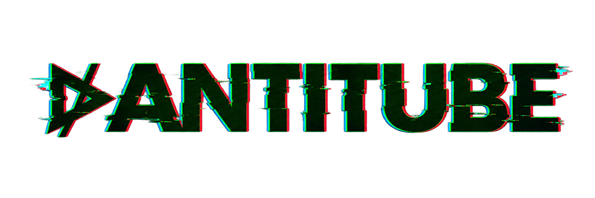
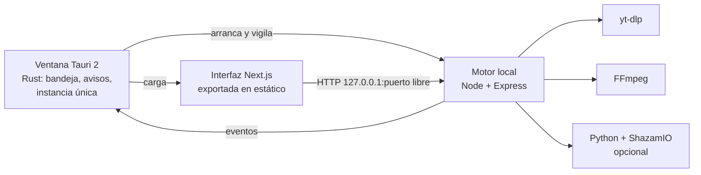

# AntiTube

<p align="center">
  
</p>

<p align="center">
  <strong>Busca, descarga, recorta y reproduce música y vídeo desde una sola app para Windows.</strong><br />
  Local, privada y con estética de terminal.
</p>

<p align="center">
  <a href="https://github.com/iKoloser/AntiTube/releases">Descargar</a> ·
  <a href="#funcionalidades">Funcionalidades</a> ·
  <a href="#instalación">Instalación</a> ·
  <a href="#arquitectura">Arquitectura</a> ·
  <a href="#desarrollo">Desarrollo</a> ·
  <a href="#solución-de-problemas">Solución de problemas</a>
</p>

> AntiTube se ejecuta en tu propio ordenador. Úsalo únicamente con contenido que tengas derecho a descargar o transformar, y respeta las condiciones de cada plataforma.

AntiTube es una aplicación de escritorio para Windows hecha con [Tauri 2](https://tauri.app/). Busca y descarga contenido de YouTube, YouTube Music, Bandcamp, Audius, SoundCloud y cualquier sitio compatible con [yt-dlp](https://github.com/yt-dlp/yt-dlp). Recorta el fragmento exacto que quieres viéndolo antes y lo guarda en el formato real que emite la plataforma. Incluye un reproductor de música y vídeo con biblioteca, listas, ecualizador y visualizador.

> **Estado:** versión **1.0 BETA**. Sale de beta cuando se confirme que todo funciona bien en uso real.

## Funcionalidades

### Buscar y descargar

- **Buscador integrado** en YouTube, YouTube Music, Bandcamp, Audius y SoundCloud. Se buscan varias plataformas a la vez y cada resultado se puede escuchar, ver, abrir con todas las opciones o mandar directo a la cola.
- **Escuchar en streaming sin descargar:** «Escuchar» reproduce solo el audio al momento y sigue con el resto de resultados como una cola; «Escuchar todo» los pone todos, ＋ añade uno a la cola y una playlist pegada también se puede escuchar entera. La siguiente canción se prepara por adelantado para que no haya silencios.
- **Pega cualquier enlace** de los más de 1.000 sitios que soporta yt-dlp: YouTube, TikTok, Twitch, Twitter/X, Vimeo, Instagram, Reddit, Bilibili y más.
- **Formatos de audio reales**, sin conversiones que empeoren el sonido:
  - **M4A (AAC)** y **OPUS** se guardan tal cual los emite la plataforma.
  - **FLAC** solo se ofrece cuando la fuente es de verdad sin pérdida.
  - **MP3** de 128 a 320 kbps cuando lo que necesitas es compatibilidad.
- **Vídeo MP4** con la calidad que elijas, incluidos 4K y 8K. No hay límite de tamaño por archivo.
- **Recorte con vista previa:** ves o escuchas el contenido dentro de la app y marcas inicio y fin arrastrando, con botones o escribiendo los tiempos. Los cortes de vídeo son exactos al fotograma.
- **Descargas en paralelo:** eliges cuántas a la vez, de 1 a 5, con progreso, velocidad y tiempo restante de cada una.
- **Playlists** con la lista previa, para elegir qué elementos bajar. Una canción que falle no detiene las demás.
- **Lote de enlaces:** pega muchas URLs de golpe.
- **Descarga rápida:** un botón en cada resultado de búsqueda con tus ajustes favoritos.
- **Etiquetas y portada** incrustadas en los archivos de audio.

### Reproductor de música y vídeo

- **Biblioteca** que lee tu carpeta de descargas y las carpetas que añadas, o los archivos que arrastres desde el Explorador. Tiene vistas de canciones, vídeos, álbumes y artistas, y un filtro instantáneo.
- **Abre casi cualquier formato:** MP3, M4A/AAC, ALAC, FLAC, OPUS, OGG, WAV, AIFF, WMA, APE, WavPack, DSF y más. En vídeo, MP4, WEBM, MKV, MOV, AVI, WMV, FLV y TS. Lo que el reproductor no abre de forma directa se prepara al vuelo, sin pérdida siempre que es posible.
- **Listas de reproducción y cola:** arrastra canciones a una lista, a la cola o a una posición concreta, o selecciona varias a la vez.
- **Controles completos:** aleatorio, repetir una o todas, velocidad de 0,5× a 2×, temporizador para dormir con bajada suave de volumen y teclas multimedia de Windows.
- **Ecualizador de 10 bandas** con preamplificador y preajustes (Graves +, Voces, Rock, Electrónica…).
- **Visualizador** en tres estilos: radial, barras y onda.
- **Vídeo:** modo cine, pantalla completa (doble clic o tecla F), imagen en imagen, ajustar o rellenar, y una ventanita flotante que sigue reproduciendo si cambias de página.
- **Vista previa en streaming:** escucha o ve un resultado de búsqueda sin descargarlo.

### Integración con Windows

- **Icono en la bandeja del sistema** con controles del reproductor (reproducir/pausar, anterior, siguiente) y acceso a las descargas.
- **Avisos de Windows** cuando termina o falla una descarga y la ventana no está a la vista.
- **Cerrar a la bandeja:** al cerrar la ventana, las descargas siguen. Se puede desactivar en Ajustes.
- **Instancia única:** si abres AntiTube otra vez, se muestra la ventana que ya estaba abierta.
- **Actualizaciones de la app** desde la propia app: avisa de cada versión nueva, enseña sus novedades y se instala con un clic.
- **Herramientas siempre al día:** yt-dlp, FFmpeg y ShazamIO se instalan solos en el primer arranque y se actualizan al abrir la app. No hace falta tocar nada fuera de AntiTube.

### SHAZAM

- **Reconocimiento de canciones** con [ShazamIO](https://github.com/shazamio/ShazamIO) a partir de unos segundos de audio.
- **Un clic y escucha todo el PC:** en la app de escritorio, «Escuchar el sistema» graba lo que suena por los altavoces (YouTube en el navegador, Spotify, un juego…) sin elegir ventana ni pestaña. En la versión web se comparte una pestaña con audio.
- Enlaces al resultado en YouTube, SoundCloud y Spotify, y descarga directa en MP3.

### Interfaz

- **Consola viva:** el fondo es un horizonte de rejilla en perspectiva con lluvia de datos y chispas que laten con los graves de lo que suena.
- **Cinco temas de color:** Cian, Matrix (verde fósforo), Ámbar (monitor CRT), Neón (cyberpunk) y Red team. Todo el diseño, el fondo y el visualizador cambian de color.
- **Paleta de comandos** con <kbd>Ctrl</kbd> <kbd>K</kbd>, estilo terminal: navegar, controlar la música, buscar en tu biblioteca o en internet, abrir un enlace y cambiar el tema sin tocar el ratón.
- **Modo inmersivo:** lo que suena a pantalla completa con un visualizador enorme, la portada girando y el título con efecto glitch.
- **Arranque como una terminal:** cada paso real del arranque aparece como una línea del registro.
- **Telemetría en vivo** en la barra superior: velocidad total de descarga con su gráfica, descargas activas y reloj.
- **Efecto CRT** opcional (líneas de barrido) y transiciones de escaneo entre secciones. Las animaciones se pueden reducir en Ajustes.
- **Adaptable:** funciona desde ventanas grandes hasta muy estrechas, con navegación lateral plegable, y la música no se corta al cambiar de sección.

## Instalación

1. Ve a [Releases](https://github.com/iKoloser/AntiTube/releases) y descarga el último `AntiTube_<versión>_x64-setup.exe`.
2. Ejecútalo. No necesita permisos de administrador.
3. Al abrir la app por primera vez, el asistente descarga yt-dlp y FFmpeg (y SHAZAM si quieres) con barra de progreso.

Windows puede avisar con SmartScreen porque el instalador no está firmado: pulsa **Más información › Ejecutar de todas formas**.

Las descargas se guardan en **Descargas › AntiTube**. La carpeta se puede cambiar en Ajustes.

## Arquitectura



| Parte | Tecnología |
| --- | --- |
| Ventana, bandeja, avisos, instalador | Rust, Tauri 2, NSIS |
| Interfaz | Next.js 16, React 19, TypeScript, CSS propio |
| Reproductor | Web Audio (ecualizador, visualizador), Media Session |
| Motor local | Node 22, Express 5, TypeScript, empaquetado con esbuild |
| Descargas y búsqueda | yt-dlp, APIs públicas de Bandcamp y Audius |
| Conversión y vídeo | FFmpeg |
| Metadatos de la biblioteca | music-metadata |
| Reconocimiento | Python + ShazamIO |

- El motor solo escucha en `127.0.0.1`, en un puerto libre que se elige al arrancar. En escritorio no hay clave de acceso.
- Cada descarga trabaja en su propia carpeta temporal y solo pasa a la carpeta final cuando está completa.
- El motor avisa a la ventana de Rust (descarga terminada, cola) para que esta muestre los avisos de Windows y actualice la bandeja.

## Estructura

```text
AntiTube/
├── desktop/               # App de escritorio Tauri 2 (Rust) y script de empaquetado
│   └── src-tauri/         # Ventana, bandeja, avisos, imágenes del instalador
├── frontend/              # Interfaz Next.js
│   └── app/
│       ├── player/        # Reproductor global, ecualizador, visualizador, arrastrar y soltar
│       ├── reproductor/   # Biblioteca, listas y pantalla «Ahora suena»
│       ├── shell/         # Marco de la app, iconos y avisos
│       └── ...            # Descargar, Descargas, SHAZAM, Ajustes
├── backend/               # Motor local Express
│   └── src/
│       ├── downloader.ts  # yt-dlp: formatos reales, recortes, playlists
│       ├── jobs.ts        # Cola de descargas en paralelo
│       ├── media.ts       # Búsqueda y vista previa en streaming
│       ├── library.ts     # Biblioteca, listas, conversión para reproducir
│       ├── setup.ts       # Instalación y actualización de herramientas
│       └── appUpdate.ts   # Actualizaciones de la app
└── .github/workflows/desktop.yml  # Compila y publica el instalador
```

## Desarrollo

Necesitas [Node.js 22](https://nodejs.org/), pnpm (`corepack enable`), yt-dlp y FFmpeg.

```bash
pnpm install
pnpm dev          # interfaz en http://localhost:3000 y motor en http://localhost:4000
pnpm typecheck
```

Para la app de escritorio necesitas además [Rust](https://rustup.rs/) y, en Windows, las [Build Tools de Visual Studio](https://tauri.app/start/prerequisites/#windows):

```powershell
pnpm desktop:dev     # app de escritorio con recarga en caliente
pnpm desktop:build   # instalador en desktop\src-tauri\target\release\bundle\nsis\
```

### Publicar una versión

1. Sube la versión en `desktop/src-tauri/tauri.conf.json`, `desktop/package.json` y `desktop/src-tauri/Cargo.toml`.
2. Haz push a la rama `desktop`. GitHub Actions compila el instalador en Windows y publica la release `desktop-v<versión>`.
3. El mensaje del último commit aparece como «Novedades» en la release y en el aviso de actualización de la app.

### Versión web (opcional)

El mismo código funciona como web privada con un único usuario: define `ANTITUBE_ACCESS_KEY` en `.env` (copia `.env.example`). La clave se valida en el motor y la sesión usa una cookie `HttpOnly`. Sírvela por HTTPS. En modo web se mantiene un límite de 500 MB por archivo (`MAX_DOWNLOAD_BYTES`).

## Solución de problemas

### Avisos de «n challenge» o faltan formatos de YouTube

YouTube cambia a menudo y solo la última versión de yt-dlp sabe seguirle el ritmo. AntiTube lo actualiza solo al abrirse. También puedes hacerlo en **Ajustes › Herramientas › Actualizar**.

### «Este contenido está protegido con DRM»

Algunos temas de SoundCloud (Go+) y de otras plataformas están cifrados y no se pueden descargar. Prueba a buscarlos en YouTube Music, Bandcamp o Audius.

### Un archivo no se reproduce

Los formatos que el reproductor no abre de forma directa se preparan con FFmpeg la primera vez. Si falla, comprueba en **Ajustes › Herramientas** que FFmpeg está instalado.

### SHAZAM no está disponible

Instálalo desde **Ajustes › Herramientas**. Si no hay Python en el equipo, AntiTube descarga uno privado (unos 30 MB) que no toca el sistema.
