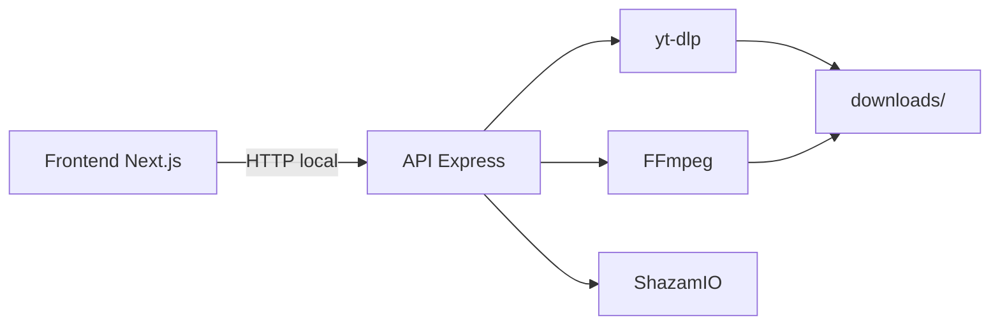

# AntiTube

<p align="center">
  
</p>

<p align="center">
  Aplicación multimedia local, privada y educativa para analizar, reconocer y descargar contenido autorizado.
</p>

<p align="center">
  <a href="#inicio-rápido">Inicio rápido</a> ·
  <a href="#funcionalidades">Funcionalidades</a> ·
  <a href="#arquitectura">Arquitectura</a> ·
  <a href="#solución-de-problemas">Solución de problemas</a>
</p>

> AntiTube está pensado para ejecutarse en tu propio ordenador. Úsalo únicamente con contenido que tengas derecho a descargar o transformar.

AntiTube es una aplicación web privada y local para trabajar con contenido multimedia con fines educativos. Recibe una URL, identifica su plataforma, consulta metadatos y permite preparar salidas MP4 o MP3 mediante `yt-dlp` y FFmpeg. También incorpora una pestaña SHAZAM para capturar hasta 12 segundos del audio de una pestaña del navegador y reconocer la canción con ShazamIO.

## Funcionalidades

- Análisis local de URLs y detección de plataforma.
- Preview de título, canal, duración, miniatura y dominio antes de descargar.
- Descarga de vídeo MP4 con calidades seleccionables.
- Extracción de audio MP3 con calidades de 128 a 320 kbps.
- Playlists con lista previa, progreso por elemento y un único ZIP final.
- Descargas de YouTube, SoundCloud, TikTok, Twitch Clips, Twitter/X y otros sitios compatibles con `yt-dlp`.
- Pestaña **SHAZAM** con captura de audio del navegador, reconocimiento y enlaces a YouTube, SoundCloud, Spotify y Shazam.
- Descargas MP3 desde YouTube/SoundCloud en los resultados de SHAZAM; Spotify se muestra como enlace oficial.
- Actividad del backend y progreso visible durante las tareas largas.
- Acceso privado de una sola clave, sin registro ni usuarios.

## Vista del proyecto

El logo utilizado por la interfaz se incluye en el repositorio para que GitHub pueda mostrarlo sin depender de servicios externos:


El flujo principal de la aplicación es:



## Arquitectura

| Parte | Tecnología | Puerto |
| --- | --- | ---: |
| Interfaz | Next.js, React, TypeScript, Tailwind/PostCSS | `3000` |
| API | Express, TypeScript | `4000` |
| Descargas | yt-dlp | proceso local |
| Conversión | FFmpeg | proceso local |
| Reconocimiento | Python + ShazamIO | proceso local |

## Estructura

```text
AntiTube/
├── frontend/              # Next.js, React, TypeScript y Tailwind CSS
├── backend/               # API Express y TypeScript
├── docker-compose.yml     # Empaquetado Docker futuro
├── package.json           # Scripts comunes del monorepo
├── pnpm-workspace.yaml    # Declaración de los paquetes del monorepo
├── .env.example           # Variables de entorno de ejemplo
└── README.md
```

## Requisitos

Instala [Node.js](https://nodejs.org/) (se recomienda una versión LTS actual) y activa pnpm mediante Corepack:

```bash
corepack enable
corepack prepare pnpm@10.15.1 --activate
```

Comprueba la instalación:

```bash
node --version
pnpm --version
```

Para esta fase no necesitas Docker. Instala también `yt-dlp` y FFmpeg:

```powershell
winget install --id yt-dlp.yt-dlp --exact
```

Ese paquete instala `yt-dlp`, FFmpeg y sus dependencias. AntiTube activa Node.js como runtime JavaScript de yt-dlp para evitar avisos de extracción de YouTube. Cierra y vuelve a abrir PowerShell después de instalarlo para actualizar `PATH`.

Para activar la pestaña **SHAZAM**, instala Python y la dependencia oficial de ShazamIO:

```powershell
python -m pip install -r backend/requirements.txt
```

ShazamIO reconoce un fragmento de audio desde un archivo o bytes y devuelve los datos de la canción. [Documentación de ShazamIO](https://github.com/shazamio/ShazamIO).

## Inicio rápido

Desde la raíz del proyecto, crea tu archivo de variables y descarga las dependencias:

```bash
copy .env.example .env
pnpm install
```

En PowerShell, `copy` también funciona como alias de `Copy-Item`. El archivo `.env` define el puerto de Express, el origen permitido por CORS y la URL pública del backend.

### Acceso privado

AntiTube está preparado para alojarse online con un único usuario. Define `ANTITUBE_ACCESS_KEY` en `.env` con una clave larga y aleatoria. La clave se valida en el backend y la sesión se mantiene mediante una cookie `HttpOnly`; nunca se expone como variable pública del frontend ni debe subirse a GitHub.

En producción, sirve frontend y backend mediante HTTPS para que la cookie tenga protección `Secure` y para que la captura de audio de SHAZAM funcione correctamente.

Comprueba las herramientas multimedia:

```powershell
pnpm tools:check
```

## Arrancar el proyecto

Para desarrollo local:

```bash
pnpm dev
```

Se abrirán dos servidores:

- Frontend: http://localhost:3000
- Backend: http://localhost:4000

Para compilarlos antes de arrancar en modo producción:

```bash
pnpm typecheck
pnpm build
pnpm start
```

## Docker más adelante

Docker se conserva como una forma futura de empaquetar AntiTube. Cuando terminemos el desarrollo local, con Docker Desktop en ejecución se podrá usar:

```bash
docker compose up --build
```

Docker compila ambos paquetes y publica los mismos puertos locales: `3000` para el frontend y `4000` para el backend. Para detenerlos, usa `Ctrl+C`.

## Comprobar la conexión frontend-backend

Primero prueba la salud de la API:

```bash
curl http://localhost:4000/api/health
```

Debe responder con `{"status":"ok","service":"antitube-backend"}`. Después abre http://localhost:3000, escribe una URL completa —por ejemplo `https://www.youtube.com/watch?v=ejemplo`— y pulsa **Analizar**. La página mostrará la plataforma, el dominio y la URL normalizada devueltos por Express.

También puedes probar la API directamente:

```bash
curl -X POST http://localhost:4000/api/analyze -H "Content-Type: application/json" -d "{\"url\":\"https://vimeo.com/123\"}"
```

## Endpoints

- `GET /api/health`: confirma que Express está disponible.
- `POST /api/analyze`: recibe `{ "url": "https://..." }`; valida HTTP/HTTPS y devuelve dominio y plataforma detectada. Una URL inválida devuelve HTTP 400 y un mensaje explicativo.
- `POST /api/metadata`: consulta metadatos mediante `yt-dlp` con `--skip-download`. Requiere que `yt-dlp` esté instalado localmente; no escribe ni descarga archivos multimedia. Puedes enviar `playlist: true` para obtener el título, el número y la lista de elementos de una playlist (hasta `MAX_PLAYLIST_ITEMS`).
- `POST /api/download`: recibe `{ "url": "https://...", "format": "mp4" | "mp3", "quality": "720", "playlist": false, "playlistTotal": 12 }` e inicia una tarea asíncrona. `playlistTotal` permite mostrar desde el primer momento el total de elementos. TikTok y Twitch Clips solo admiten `mp4`. Devuelve un `jobId` para consultar el progreso.
- `GET /api/download/:jobId`: devuelve el estado (`queued`, `downloading`, `completed` o `failed`), porcentaje, velocidad, ETA, últimas líneas de actividad del backend y, al terminar, el enlace de descarga. Para una playlist genera un único ZIP con el nombre de la playlist y canciones con el título del vídeo; para una descarga individual devuelve un archivo con su título. Para MP4 se admiten `best`, `360`, `480`, `720` y `1080`; para MP3, `128`, `192`, `256` y `320` kbps. Con `playlist: true` descarga hasta `MAX_PLAYLIST_ITEMS` elementos (50 por defecto), con un límite de 500 MB por archivo y una tarea simultánea.
- `GET /api/downloads/:filename`: sirve un archivo generado por una descarga válida.
- `POST /api/shazam/recognize`: recibe un fragmento de audio en base64, lo reconoce con ShazamIO y devuelve título, artista, portada y enlaces para YouTube, SoundCloud y Spotify. Desde la interfaz, YouTube y SoundCloud permiten buscar y preparar una descarga MP3; Spotify se mantiene como enlace oficial.
- `POST /api/auth/login`, `GET /api/auth/session` y `POST /api/auth/logout`: gestionan el acceso de clave única. El resto de endpoints requiere una sesión válida.

La interfaz muestra automáticamente título, miniatura, plataforma y enlace al contenido original. También incluye un índice visible de plataformas: YouTube, TikTok, Twitch Clips, Twitter/X, Vimeo, Instagram, Facebook, Reddit, SoundCloud, Bandcamp, Dailymotion, Bilibili, Rumble, Kick, VK y Streamable, además de otros sitios compatibles con `yt-dlp`. La pestaña **SHAZAM** permite compartir una pestaña con audio, grabar hasta 12 segundos y consultar la canción reconocida en YouTube, SoundCloud y Spotify. Si la URL parece una playlist, la detecta automáticamente, muestra sus canciones numeradas antes de descargar, marca visualmente las ya procesadas y ofrece un único botón para descargar toda la playlist. En ese caso la preview usa un placeholder de playlist y el resumen indica un ZIP, no un MP3. Twitter/X, TikTok y Twitch Clips se analizan y descargan mediante `yt-dlp`, con MP4 obligatorio para TikTok y Twitch Clips.

## Pendiente

Las descargas requieren que tengas autorización para usar el contenido y respeten las condiciones de la plataforma. Docker sigue pendiente como empaquetado final; el desarrollo actual funciona directamente con Node.js, `yt-dlp` y FFmpeg.

## Solución de problemas

### `yt-dlp no está instalado o no está disponible en PATH`

Comprueba la herramienta y reinicia PowerShell para actualizar el `PATH`:

```powershell
yt-dlp --version
ffmpeg -version
```

También puedes iniciar el proyecto con `iniciar-antitube.bat`, que localiza `pnpm`, `yt-dlp` y Python antes de arrancar los servidores.

### SHAZAM no recibe audio

Usa Chrome o Edge, reproduce la música en otra pestaña. Activa **Compartir audio** en el diálogo del navegador. El audio se procesa localmente mediante el backend y el archivo temporal se elimina después del reconocimiento.

### El backend no encuentra ShazamIO

Instala la dependencia con el mismo Python configurado en `.env`:

```powershell
python -m pip install -r backend\requirements.txt
```

Si tienes varias instalaciones de Python, configura `PYTHON_BIN` con la ruta completa del ejecutable.

