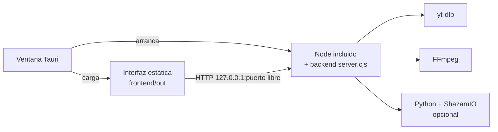

# AntiTube para escritorio

Versión instalable de AntiTube construida con [Tauri 2](https://tauri.app/). Usa el navegador integrado del sistema (WebView2 en Windows), así que el instalador es pequeño y la app consume poca memoria.

## Cómo funciona



1. Al abrir la app, Tauri elige un puerto libre en `127.0.0.1` y arranca el backend Express con el Node que va dentro del instalador.
2. La interfaz muestra una **pantalla de arranque** con cada paso: ventana, motor local y comprobación de herramientas.
3. Si faltan yt-dlp o FFmpeg, aparece el **asistente de primer arranque**: explica qué hace cada herramienta, las descarga con barra de progreso en `%LOCALAPPDATA%\com.ikoloser.antitube\tools` y las verifica. No hacen falta permisos de administrador. Si ya están instaladas en el sistema, se usan directamente.
4. SHAZAM es opcional: si hay Python en el equipo, el asistente puede instalar ShazamIO con `pip --user`.
5. Las descargas se guardan en **Descargas › AntiTube** y el botón «Mostrar en la carpeta» abre el explorador con el archivo seleccionado.
6. Al cerrar la ventana se detiene el backend.

En escritorio no se pide clave de acceso: el backend solo escucha en `127.0.0.1`. La página **Herramientas** muestra versiones, permite actualizar yt-dlp y abre la carpeta de descargas.

## Compilar el instalador de Windows

La forma más sencilla es GitHub Actions: cada push a la rama `desktop` ejecuta `.github/workflows/desktop.yml` en Windows y deja el instalador `AntiTube_x.y.z_x64-setup.exe` como artefacto descargable. Con una etiqueta `desktop-v0.1.0` además crea un borrador de release.

Para compilarlo en tu PC con Windows necesitas Node 22, pnpm, [Rust](https://rustup.rs/) y las [Build Tools de Visual Studio](https://tauri.app/start/prerequisites/#windows) («Desarrollo para el escritorio con C++»):

```powershell
pnpm install
pnpm desktop:build
```

El instalador queda en `desktop\src-tauri\target\release\bundle\nsis\`.

## Desarrollo

```powershell
pnpm desktop:dev
```

Arranca Next.js en modo desarrollo y abre la ventana de Tauri apuntando a él, con el backend en modo escritorio.

## Archivos

| Ruta | Qué contiene |
| --- | --- |
| `scripts/prepare.mjs` | Exporta el frontend, empaqueta el backend con esbuild y copia el runtime de Node a `src-tauri/resources/`. |
| `src-tauri/src/main.rs` | Arranque del backend, ventana, enlaces externos al navegador y cierre limpio. |
| `src-tauri/tauri.conf.json` | Nombre, icono, recursos e instalador NSIS (por usuario, en español). |
| `app-icon.svg` / `app-icon.png` | Icono de la app, generado a partir del emblema del logo. |
| `../backend/src/setup.ts` | Detección e instalación de yt-dlp, FFmpeg y ShazamIO. |
| `../frontend/app/desktop/` | Pantalla de arranque y asistente de herramientas. |
